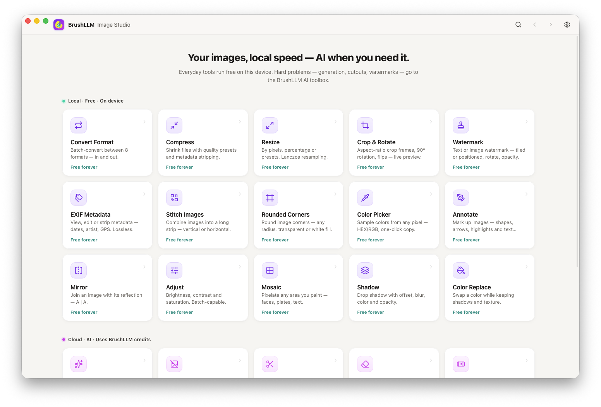

# BrushLLM Image Studio

[English](../README.md) | [Deutsch](README.de.md) | [Español](README.es.md) | [Français](README.fr.md) | [Português (Brasil)](README.pt-BR.md) | [日本語](README.ja.md) | [简体中文](README.zh-CN.md) | [繁體中文](README.zh-TW.md) | [한국어](README.ko.md)

Uma caixa de ferramentas de imagens local-first — 15 ferramentas locais rodam grátis na sua máquina; 7 edições com IA usam o gateway BrushLLM.

  

---

**Funções:** converter formato (8 de entrada / 8 de saída) · comprimir com presets de qualidade · redimensionar (Lanczos) · cortar e girar · espelhar (A \| A) · ajustar · juntar imagens · marca d'água · EXIF · cantos arredondados · conta-gotas · anotar · mosaico · sombra · trocar cor (até 6 pares).

**Ferramentas de IA (nuvem, por imagem):** gerar imagem · remover fundo · recortar sujeito · remover marca d'água · remover objeto · preenchimento generativo (com imagens de referência) · mudar estilo.

**Destaques:** interface em 9 idiomas · modo escuro · paleta de comandos ⌘K · processamento em lote · verificação manual de atualizações · zero telemetria.

**📥 Baixar:** instaladores em [Releases](https://github.com/BrushLLm/brushllm-image-studio/releases) — macOS `.dmg` (Apple Silicon), Windows `.exe` (x64 / ARM64). Apps não assinados: no primeiro início no macOS, clique com o botão direito → *Abrir*; no Windows escolha *Executar mesmo assim* no SmartScreen.

Desenvolvimento e arquitetura: veja a seção [English](../README.md).

