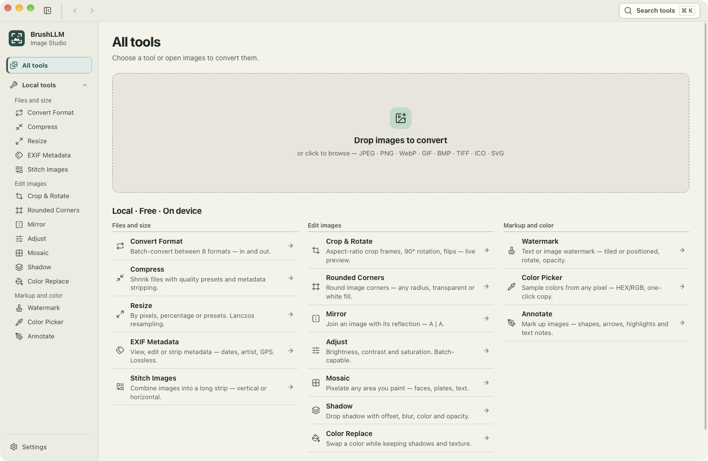

# BrushLLM Image Studio

在 macOS 和 Windows 上編輯圖片。本機工具在裝置上免費執行，無須註冊帳號。

**[下載最新版本](https://github.com/BrushLLM/brushllm-image-studio/releases/latest)** · [產品頁](https://brushllm.com/zh-TW/studio/)

[English](../README.md) · [Deutsch](../docs/README.de.md) · [Español](../docs/README.es.md) · [Français](../docs/README.fr.md) · [Português (Brasil)](../docs/README.pt-BR.md) · [日本語](../docs/README.ja.md) · [한국어](../docs/README.ko.md) · [简体中文](../docs/README.zh-CN.md) · [繁體中文](../docs/README.zh-TW.md)

## 下載

| 系統 | 安裝程式 |
| --- | --- |
| macOS Apple Silicon | `*-arm64.dmg` |
| Windows x64（Intel 或 AMD） | `*-x64.exe` |
| Windows ARM64 | `*-arm64.exe` |

macOS 請開啟磁碟映像，將 App 拖入「應用程式」。Windows 請執行符合裝置架構的安裝程式。安裝檔未簽署。

## 本機圖片工作流程

1. 在工作區開啟或拖入圖片，從側邊欄選擇工具。
2. 批次轉換、壓縮或調整大小。單張圖片也可以裁切、旋轉、調色、加浮水印或標註。
3. 預覽並比較結果。選取輸出資料夾及同名檔案的處理方式，再匯出。

批次匯入支援 JPEG、PNG、WebP、GIF（首個影格）、BMP、TIFF、ICO 和 SVG。可匯出 JPEG、PNG、WebP、AVIF、TIFF、BMP、ICO 和內嵌點陣圖的 SVG。

## 開發

[建置及測試](../README.md#development)
